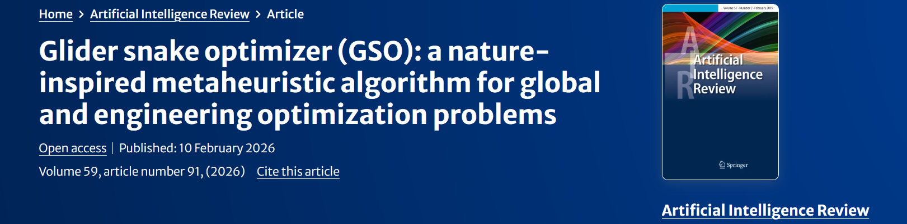
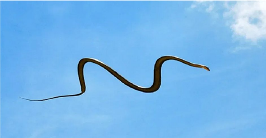
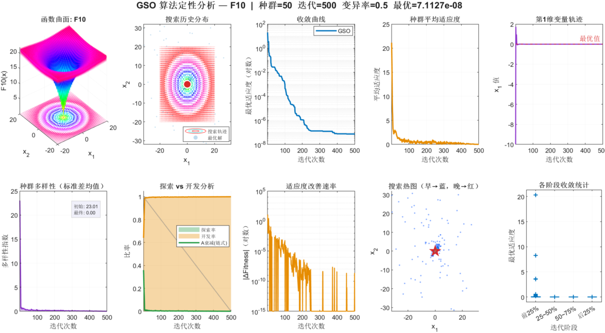
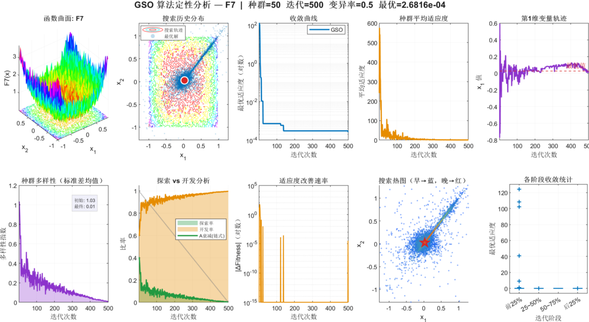
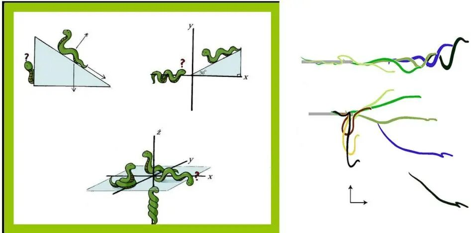
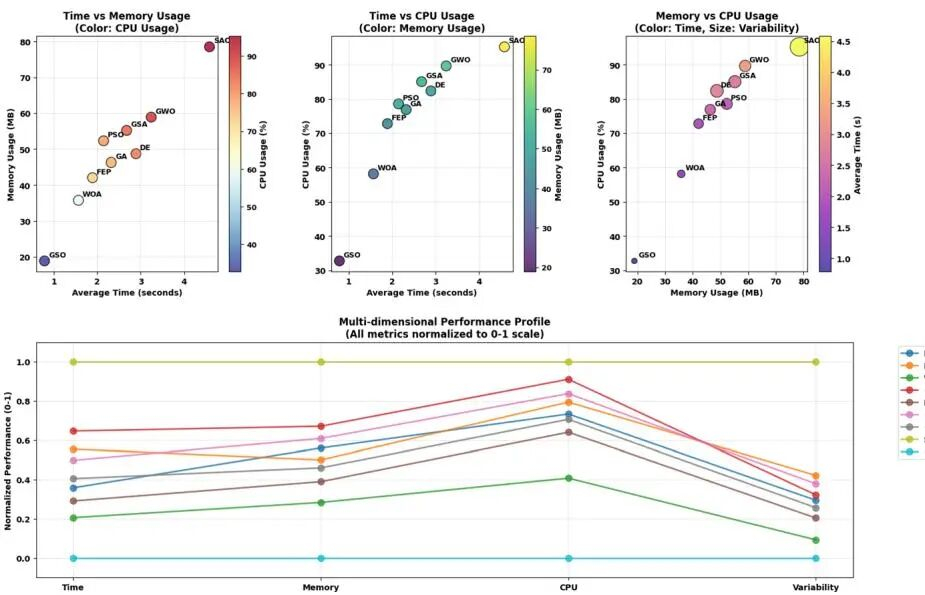
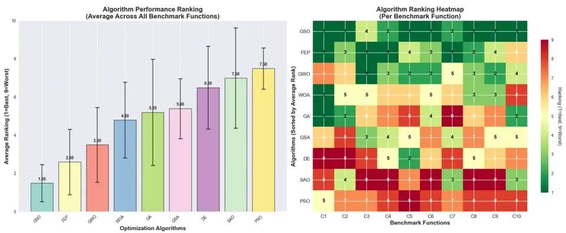

# 2026 Top Optimization! Gliding Snake Optimization (GSO) for Sliding Algorithms, Explanation of Principles + Search Distribution Map, Population Diversity, and Analysis of Exploration vs. Development

Run on platform: MATLAB R2023a and above, no additional toolboxes required, one-click operation.
Documentation interpretation
References: Glider snake optimizer (GSO): a nature-inspired metaheuristic algorithm for global and engineering optimization problems, El-kenawy (First-Class Category at the Chinese Academy of Sciences, IF=13.9)
In February 2026, a paper published in Artificial Intelligence Review (First-Class Category at the Chinese Academy of Sciences, IF=13.9) proposed a new biomimetic algorithm—the glider snake optimizer algorithm (Glider Snake Optimizer, GSO). It was inspired by the flying behavior of the chrysopelea (Chrysopelea), organizing the population into a chain structure. Each agent simultaneously follows both the global leader and the predecessors in the chain to update its position, completely breaking away from the single-guide limitation of traditional algorithms where "all individuals converge towards the optimal solution."
Improvement work in this article—Why is only convergence curve sufficient?
The SCI algorithmic papers know that the convergence curve can only indicate "the results have improved," but it is difficult to answer more critical questions: how does the algorithm actually search? How does the population transition from dispersion to contraction? Is exploration and development smooth or abruptly collapsed? Does the search process exhibit premature convergence, local stagnation, or loss of diversity? These questions cannot be explained simply by benchmark numerical values and final optimal values. What truly supports the analysis of algorithmic mechanisms is multi-dimensional qualitative visualization. Therefore, in this paper, we further added 10 types of visualization analysis charts in classic test function experiments, including: ① Three-dimensional fitness landscape; ② Search history scatter plot; ③ Half-logarithmic convergence curve; ④ Population average fitness curve; ⑤ First dimension variable trajectory chart; ⑥ Population diversity curve; ⑦ Change in exploration-exploitation ratio curve; ⑧ Logarithmic improvement rate of fitness curve; ⑨ Heatmap during search phase; ⑩ Boxplot of stage convergence. The results are as follows:
The "Single Leader Dilemma" of the Algorithm of Metaheuristics
Existing mainstream heuristic algorithms—WOA's whale bubble network, GWO's grey wolf hunting, and PSO's particle velocity update—unanimously employ a single-leader guiding mechanism: all individuals converge towards the same current optimum position. This structure is evidently vulnerable in multimodal landscapes: once the leader falls into local extremities, the entire population is swamped and converged, diversity plummets, and the probability of breaking out of local extremities approaches zero. Moreover, the exploration and development switching of traditional algorithms highly relies on manual tuning, lacking adaptability, and is extremely sensitive to hyperparameter settings.
The gliding snake optimizer (GSO) has completely restructured the information flow structure of the population: modeling each agent as a segment on a snake chain, while simultaneously obtaining guidance from both the global leader and the forerunners in the chain, forming a dual attraction field. Coupled with an adaptive coefficient and weak individual replacement mechanism, it achieves the automatic switch between exploration and development without human intervention.
3. Core Mechanisms, Detailed Analysis:
1.1 Dual-Guided Exploration Update - Coordinated Search Driven by a Chain-Structured Approach
The core innovation of GSO lies in organizing candidate solutions into a chain-structured approach.
2. Adaptive Decay Coefficient - Unconstrained Switching between Exploration and Development
Linear decay coefficient controls the step size during the initial stages of the search process, with large position updates covering broad areas of the search space (exploration-dominated). As iteration progresses, the linear decay approaches zero, reducing the step size to achieve fine-grained local development. The entire transition from exploration to development is driven entirely by the formula, eliminating the need for manual setting of stage switching times, simplifying parameters while ensuring global coverage and local precision.
3. Weakly Intelligent Agent Adaptive Replacement - Population Diversity Ensuring Mechanism
Experimental Performance
23 Classic Benchmark Functions - Comprehensive Lead
1. On F1–F23 (including unimodal F1–F7, multimodal F8–F13, and fixed-dimensional multimodal F14–F23), GSO outperforms PSO, DE, WOA, GWO, GA, CMA-ES, LSHADE-SPACMA, PIMO, RBMO, OOA, ISO, among 11 algorithms, achieving the lowest mean and smallest standard deviation on most functions, ranking first overall.
F1 (Sphere function) is particularly significant: In a 500-dimensional scenario, GSO's mean is comparable to that of competitive PSO; in a 1000-dimensional scenario, it reaches a mean of , with a standard deviation of 0, meaning all 30 independent runs converge to numerical precision limits, whereas PSO/WOA completely fail under the same dimensionality.
CEC2019 Constrained Optimization (C1–C10) - Radar Chart Overall First
In the CEC2019 10 constraints engineering problems, compared with CMA-ES, LSHADE-SPACMA, PIMO, RBMO, OOA, and ISO, GSO ranked first in four categories: C5 (mean 1.08, lowest), C6 (mean 1.69, lowest), C8 (mean 676, lowest), and C10 (mean 19.1, lowest). It had the smallest normalized radar chart integrated area, demonstrating a significant overall advantage.
4 engineering design problems - all optimal solutions
Problem
GSO Optimal Solution
Second-best algorithm
Pressure vessel design
5885.34GWO: 5993.59
Tension/compression spring design
0.0126652PSO: 0.0126747
Welded beam design
1.724921PSO: 1.728024
Speed reducer design
2996.7160GA: 2999.33
Algorithm computational complexity: time complexity (population size, problem dimension), is of the same order as mainstream algorithms such as PSO and GWO, suitable for large-scale engineering scenarios for deployment.
Follow the editor to regularly push high innovative, high-quality learning materials, articles, and code, fueling your research efforts~

## Images

<!-- PAYMENT_BLOCK -->

## Get this dataset

- Payment link (Stripe): [Buy now](https://buy.stripe.com/3cs8yP7sY87d0vu9AB)
- Payment QR code: 

<!-- /PAYMENT_BLOCK -->
